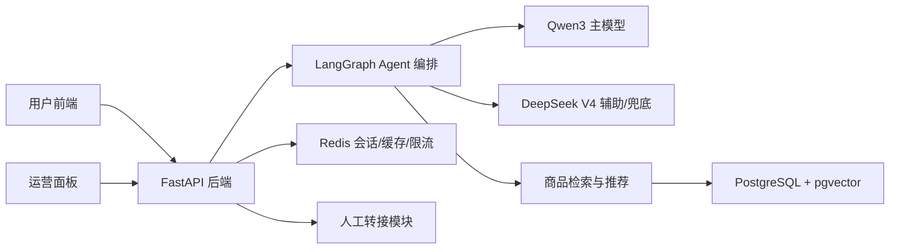
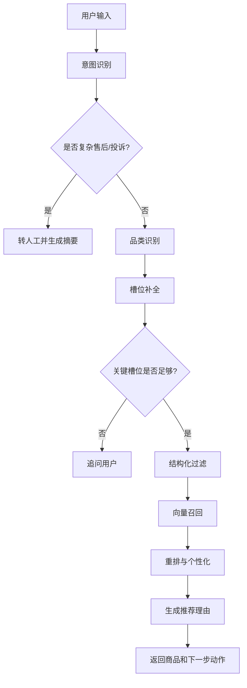

# 数码全类智能导购 Agent

## 1. 项目定位

本项目是一个面向数码全类商品的智能导购 Agent，目标是替代基础人工客服完成售前咨询、选品推荐、商品对比、下单引导和复杂售后转人工。

第一版聚焦商用 MVP，不直接接入真实电商平台，先使用自建模拟商品库验证完整业务闭环。覆盖品类包括手机、笔记本、平板、耳机、相机、智能手表等典型数码产品。

### 1.1 核心问题

传统电商客服在数码导购场景中常见问题：

- 咨询响应慢，用户等待时间长。
- 用户需求模糊时，人工客服追问成本高。
- 商品参数复杂，推荐容易只罗列配置，缺少购买理由。
- 用户历史行为、预算、使用场景没有被充分利用。
- 售后、投诉、保修争议转人工时上下文丢失。

### 1.2 目标能力

- 支持多轮对话，识别模糊、歧义和跨品类需求。
- 根据预算、品牌、用途、参数偏好和用户历史行为补全需求。
- 对接商品库做结构化筛选、语义召回和个性化推荐。
- 为每个推荐商品生成可信、可解释、和用户需求相关的推荐理由。
- 支持 2-3 个商品的参数对比、适合人群分析和购买建议。
- 针对投诉、退款、保修争议、低置信度回答自动转人工，并同步会话摘要。

## 2. 技术栈选型

| 模块 | 技术 | 选择原因 | 替代方案与取舍 |
|---|---|---|---|
| 后端 API | FastAPI | Python 生态友好，适合 AI 服务；类型校验、异步能力和自动 API 文档完善 | Flask 更轻但工程约束弱；Django 偏重，不适合 Agent MVP |
| Agent 编排 | LangGraph + LangChain | LangGraph 管理多轮状态机和分支流程；LangChain 负责模型、工具、Retriever 集成 | 纯 LangChain 对复杂状态流控制较弱；自研编排初期成本高 |
| 主模型 | Qwen3 API | 中文导购、多轮对话、结构化输出、工具调用更适合主链路 | OpenAI 效果强但成本和国内合规需评估 |
| 辅助模型 | DeepSeek V4 Flash/Pro API | 适合复杂对比、长上下文总结、复杂售后判断和模型兜底 | 全量使用 DeepSeek 可行，但主导购话术和槽位稳定性需实测 |
| 主数据库 | PostgreSQL + pgvector | 同时支持结构化数据、JSONB 参数、事务和向量检索，MVP 运维简单 | MySQL 生态成熟但向量检索集成弱；FAISS 不是完整在线数据库 |
| 缓存 | Redis | 用于会话缓存、热门推荐缓存、限流和模型调用保护 | 仅用数据库会增加延迟和并发压力 |
| 前端 | React + TypeScript + Vite + Ant Design + TanStack Query | 快速构建导购聊天页、推荐卡片、商品对比和运营面板 | Vue 也可行；本项目默认 React 生态 |
| ORM/迁移 | SQLAlchemy 2.0 + Alembic | Python 后端主流组合，适合可维护 schema 演进 | 直接写 SQL 简单但长期迁移成本高 |
| 测试 | pytest + httpx + Playwright | 覆盖后端单元、接口、Agent 场景和前端 E2E | 只做手测无法证明推荐链路稳定 |
| 部署 | Docker Compose | 本地一键启动 API、前端、PostgreSQL、Redis | Kubernetes 不适合 MVP 第一阶段 |

## 3. 系统架构

采用单体优先、模块化分层架构。第一版保持部署简单，后续可以按 Agent 服务、推荐服务、商品搜索服务拆分。



### 3.1 分层设计

| 层级 | 职责 |
|---|---|
| 前端展示层 | 聊天交互、推荐商品展示、商品对比、转人工状态、运营监控 |
| API 层 | 请求校验、鉴权预留、错误处理、接口聚合、响应格式统一 |
| Agent 编排层 | 意图识别、品类路由、槽位补全、模型路由、工具调用和状态流转 |
| 推荐检索层 | 商品结构化过滤、向量召回、排序重排、推荐理由上下文构造 |
| 数据层 | 用户、商品、会话、消息、推荐记录、反馈、人工工单 |
| 缓存层 | 会话短期状态、热点商品、限流计数、模型调用保护 |

## 4. Agent 流程设计

### 4.1 主流程



### 4.2 模型路由

| 任务 | 默认模型 | 说明 |
|---|---|---|
| 普通导购对话 | Qwen3 | 保持中文导购体验和结构化输出稳定 |
| 意图识别 | Qwen3 | 输出标准 intent、category、slots |
| 槽位补全 | Qwen3 | 根据上下文提取预算、用途、品牌、参数偏好 |
| 推荐理由生成 | Qwen3 | 结合商品真实字段生成，不允许编造参数 |
| 商品复杂对比 | DeepSeek V4 Flash | 长参数、跨品类或多商品对比时使用 |
| 长会话摘要 | DeepSeek V4 Flash | 人工转接前压缩上下文 |
| 售后争议判断 | DeepSeek V4 Pro | 退款、投诉、保修争议等低频复杂场景 |
| 主模型失败兜底 | DeepSeek V4 Flash | Qwen3 超时、失败或限流时切换 |

### 4.3 品类与核心槽位

| 品类 | 核心槽位 |
|---|---|
| 手机 | 预算、品牌、系统、拍照、游戏、续航、存储 |
| 笔记本 | 预算、用途、CPU/GPU、重量、屏幕、续航、内存 |
| 平板 | 预算、用途、屏幕、手写笔、生态、便携性 |
| 耳机 | 预算、佩戴方式、降噪、音质、通话、运动场景 |
| 相机 | 预算、拍摄场景、便携性、镜头生态、视频能力 |
| 智能手表 | 预算、手机生态、运动、健康监测、续航、外观 |

## 5. 后端设计

### 5.1 目录规划

```text
backend/
  app/
    main.py
    api/
      routes_chat.py
      routes_recommend.py
      routes_compare.py
      routes_handoff.py
      routes_feedback.py
    core/
      config.py
      logging.py
      errors.py
    agent/
      graph.py
      state.py
      prompts.py
      model_router.py
      tools.py
    catalog/
      retriever.py
      ranker.py
      vectorizer.py
      seed_data.py
    db/
      session.py
      models.py
      repositories.py
    schemas/
      chat.py
      product.py
      recommendation.py
      handoff.py
    tests/
      test_chat_api.py
      test_recommendation.py
      test_agent_flow.py
```

### 5.2 API 设计

| 接口 | 方法 | 职责 | 完成标准 |
|---|---|---|---|
| `/chat` | POST | 主对话入口，返回回复、推荐商品、下一步动作 | 能完成一次多轮导购 |
| `/recommend` | POST | 根据品类、槽位、用户历史返回商品候选 | 推荐结果来自数据库 |
| `/compare` | POST | 对比 2-3 个商品 | 输出差异、适合人群、购买建议 |
| `/handoff` | POST | 创建人工转接工单 | 包含摘要、原因、状态 |
| `/feedback` | POST | 记录点击、拒绝、购买、接管等反馈 | 后续可用于评估推荐质量 |
| `/health` | GET | 健康检查 | 返回 API、数据库、Redis 状态 |

### 5.3 响应约定

所有业务接口返回统一结构：

```json
{
  "success": true,
  "data": {},
  "error": null,
  "trace_id": "req_xxx"
}
```

错误时：

```json
{
  "success": false,
  "data": null,
  "error": {
    "code": "MODEL_TIMEOUT",
    "message": "模型响应超时，请稍后重试"
  },
  "trace_id": "req_xxx"
}
```

### 5.4 第一阶段 API 字段契约

后端 MVP 当前已支持 PostgreSQL 商品库优先读取；数据库不可用或无商品数据时自动回退到本地模拟商品库。未配置模型 API Key 时走 mock provider。

- 推荐商品字段：`id`、`name`、`category`、`brand`、`price`、`stock`、`tags`、`specs`、`selling_points`、`after_sales_policy`、`recommendation_reason`。
- `/chat` 的 `data` 字段：`reply`、`conversation_id`、`intent`、`category`、`slots`、`recommendations`、`next_action`。
- `/recommend` 的 `data` 字段：`intent`、`category`、`slots`、`recommendations`。
- `/compare` 的 `data` 字段：`products`、`diff_groups`、`ai_summary`、`best_for`。
- `/handoff` 的 `data` 字段：`ticket_id`、`conversation_id`、`reason`、`summary`、`status`。
- `/feedback` 的 `data` 字段：`feedback_id`、`conversation_id`、`product_id`、`feedback_type`、`status`。

模型配置通过环境变量注入，禁止提交真实 API Key：

```text
APP_QWEN_API_KEY=
APP_QWEN_BASE_URL=https://dashscope.aliyuncs.com/compatible-mode/v1
APP_QWEN_MODEL_NAME=qwen3.6-plus
APP_DEEPSEEK_API_KEY=
APP_DEEPSEEK_BASE_URL=https://api.deepseek.com
APP_DEEPSEEK_MODEL_NAME=deepseek-v4-flash
APP_MODEL_TIMEOUT_SECONDS=15
```

## 6. 前端设计

前端不做单一聊天 Demo，而是对标真实电商购物前台：用户可以浏览商品、筛选搜索、查看详情、加入购物车、发起导购咨询、对比商品，并在需要时转人工。AI 导购是购物链路中的智能助手，而不是孤立聊天窗口。

### 6.1 产品定位与设计原则

| 设计原则 | 说明 |
|---|---|
| 电商优先 | 首页、搜索、分类、商品卡片、详情页、购物车、下单引导必须像真实购物网站 |
| Agent 嵌入式 | AI 导购以侧边栏、浮层、推荐解释和对比助手嵌入购物流程 |
| 转化导向 | 每个推荐结果都要能继续查看详情、加入对比、加入购物车或咨询售后 |
| 参数可信 | 数码商品参数必须结构化展示，避免只靠自然语言解释 |
| 决策辅助 | 强化多商品对比、预算筛选、使用场景推荐和优缺点说明 |
| 状态透明 | 加载、空结果、低置信度、转人工、模型失败都要有明确 UI 状态 |

### 6.2 页面规划

| 页面 | 路由 | 职责 |
|---|---|---|
| 商城首页 | `/` | 频道入口、热门品类、AI 导购入口、推荐商品流 |
| 分类页 | `/category/:category` | 按手机、笔记本、平板、耳机、相机、手表浏览商品 |
| 搜索结果页 | `/search` | 关键词搜索、结构化筛选、排序、AI 解释搜索意图 |
| 商品详情页 | `/products/:id` | 商品图、价格、参数、卖点、评价摘要、售后政策、导购问答 |
| AI 导购页 | `/assistant` | 独立多轮导购会话、需求槽位、推荐列表、对比入口 |
| 商品对比页 | `/compare` | 2-3 个商品参数对比、适合人群、购买建议 |
| 购物车页 | `/cart` | 已选商品、价格汇总、导购补充建议、模拟下单 |
| 售后/人工转接页 | `/support` | 售后咨询、转人工状态、工单摘要 |
| 商品库管理 | `/admin/products` | 查看模拟商品、筛选品类、检查参数字段 |
| 会话监控 | `/admin/conversations` | 查看会话、消息、转人工原因 |
| 推荐效果面板 | `/admin/metrics` | 查看推荐点击、拒绝、转人工、下单模拟指标 |

### 6.3 商城首页设计

首页第一屏要体现真实数码电商，而不是营销空页：

- 顶部导航：Logo、搜索框、品类导航、购物车、用户入口、AI 导购快捷入口。
- 品类频道：手机、笔记本、平板、耳机、相机、智能手表。
- AI 导购入口：提供自然语言输入框，例如“预算 5000，想买轻薄办公本”。
- 推荐商品流：展示热门、降价、适合学生、适合办公、送礼优选等商品分区。
- 决策辅助模块：预算选择、使用场景选择、品牌偏好选择。

首页视觉方向采用“专业数码零售 + 智能助手”的克制风格：信息密度接近京东/天猫数码频道，但交互更轻。避免做成纯聊天机器人页面。

### 6.4 搜索与分类页设计

搜索和分类页是导购转化核心，必须支持真实电商筛选：

- 左侧或顶部筛选：品类、品牌、价格区间、用途、核心参数、库存、售后。
- 排序：综合、价格升序、价格降序、销量模拟、评分模拟、推荐度。
- 商品卡片：商品图、名称、价格、品牌、核心参数、库存、标签、推荐理由入口。
- AI 搜索解释：当用户输入“适合上班的轻薄本”时，页面展示识别出的品类、预算和用途。
- 空结果兜底：没有完全匹配时，提示放宽预算、切换品牌或让 AI 继续追问。

商品卡片必须提供这些操作：

- 查看详情
- 加入对比
- 加入购物车
- 问问 AI
- 不感兴趣

### 6.5 商品详情页设计

商品详情页要支持用户独立决策，也要支持 AI 解释：

- 商品主信息：图片、名称、价格、品牌、库存、保障服务。
- 关键卖点：用 3-5 个短标签说明适合场景，例如“长续航”“轻办公”“学生党”“拍照强”。
- 参数表：按品类展示核心参数，不同品类字段不同。
- AI 推荐理由：说明为什么适合当前用户，引用预算、用途、历史偏好。
- 对比入口：展示“与同价位商品对比”“与收藏商品对比”。
- 售后政策：退换、保修、延保、人工咨询入口。
- 用户反馈模拟：评分、问答、常见问题摘要。

### 6.6 AI 导购交互设计

AI 导购有两种形态：

- 独立导购页 `/assistant`：适合完整多轮选品。
- 全站浮动导购侧边栏：在首页、分类、搜索、详情、购物车中都可唤起。

导购界面需要展示的不只是消息：

- 对话区：用户消息、Agent 回复、追问问题、转人工提示。
- 需求槽位卡：品类、预算、用途、品牌、参数偏好、送礼对象等。
- 推荐商品区：3-5 个候选商品，展示推荐理由和操作按钮。
- 对比暂存区：用户选择的 2-3 个商品。
- 决策提示：预算超出、库存不足、参数冲突、低置信度提示。
- 模型状态：正在理解需求、正在检索商品、正在生成推荐理由、需要人工处理。

### 6.7 商品对比页设计

数码产品强依赖参数对比，对比页必须作为核心页面实现：

- 固定表头：商品图、名称、价格、购买入口。
- 参数对比：按屏幕、性能、续航、重量、影像、连接、售后等维度分组。
- 差异高亮：突出真正影响购买决策的差异，而不是所有字段平铺。
- AI 总结：给出“更适合谁”“不适合谁”“最终建议”。
- 场景切换：游戏、办公、拍照、送礼、长辈使用等场景下重新排序推荐。

### 6.8 购物车与模拟下单设计

购物车不做真实支付，但要保留电商转化链路：

- 展示已选商品、数量、价格、库存状态。
- 支持移除、改数量、继续咨询、加入对比。
- AI 补充建议：提醒是否需要耳机、保护壳、延保、配件。
- 模拟下单按钮：生成模拟订单事件，用于推荐效果评估。
- 风险提示：库存不足、价格变化、售后限制时阻止模拟下单。

### 6.9 运营后台设计

后台面向运营和开发调试，不面向消费者：

- 商品库管理：查看商品字段、参数 JSON、向量化状态、库存和标签。
- 会话监控：查看用户问题、Agent 意图、槽位、推荐商品、转人工原因。
- 推荐效果面板：点击率、加入购物车率、模拟下单率、拒绝率、转人工率。
- 模型观测：Qwen3/DeepSeek 调用次数、失败率、平均耗时、降级次数。
- 评测集页面：固定测试问题、期望行为、最近一次评测结果。

### 6.10 组件规划

| 组件 | 职责 |
|---|---|
| `ProductCard` | 商品图、价格、标签、核心参数、操作按钮 |
| `ProductGrid` | 商品列表、加载态、空状态、分页 |
| `FilterPanel` | 品类、品牌、价格、参数筛选 |
| `SearchIntentBar` | 展示 AI 识别出的搜索意图和槽位 |
| `AssistantDrawer` | 全站 AI 导购侧边栏 |
| `ChatTimeline` | 多轮消息和追问展示 |
| `SlotSummary` | 当前用户需求槽位 |
| `RecommendationPanel` | 推荐商品与推荐理由 |
| `CompareTable` | 参数对比、差异高亮、AI 总结 |
| `CartSummary` | 购物车价格、数量、模拟下单 |
| `HandoffBanner` | 人工转接状态和工单摘要 |
| `MetricCard` | 后台指标卡 |

### 6.11 状态与数据流

- TanStack Query 管理商品列表、详情、推荐、对比、购物车和后台指标请求。
- 前端保留轻量会话状态，包括当前 `conversation_id`、已选商品、对比列表、购物车。
- Agent 真实状态以后端 `conversations.slots` 为准，前端只展示，不自行推断。
- 商品价格、库存、推荐理由、参数均来自后端接口，不在前端写死。
- 模型失败、接口超时、空推荐结果必须有可恢复操作，例如重试、放宽筛选、转人工。

### 6.12 前端验收

- 桌面端 1440px 宽度下：首页、分类页、详情页、导购侧边栏、对比页布局清晰，不重叠。
- 移动端 390px 宽度下：搜索、商品卡片、导购聊天、详情参数、购物车都可正常使用。
- 用户可以从首页输入需求，完成推荐、查看详情、加入对比、加入购物车、模拟下单。
- 接口加载、空结果、模型失败、转人工中都有明确状态。
- 推荐卡片中的价格、参数、理由来自后端接口，不写死在前端。
- 商品对比页能展示 2-3 个商品差异，并给出 AI 购买建议。
- Playwright 截图检查桌面端和移动端无明显布局错位、文字溢出、按钮遮挡。

## 7. 数据库设计

### 7.1 核心表

#### users

| 字段 | 类型 | 说明 |
|---|---|---|
| id | UUID | 用户 ID |
| nickname | VARCHAR | 昵称 |
| preferences | JSONB | 品牌、预算、品类偏好 |
| member_level | VARCHAR | 会员等级 |
| created_at | TIMESTAMP | 创建时间 |

#### products

| 字段 | 类型 | 说明 |
|---|---|---|
| id | UUID | 商品 ID |
| name | VARCHAR | 商品名称 |
| category | VARCHAR | 品类 |
| brand | VARCHAR | 品牌 |
| price | NUMERIC | 当前价格 |
| stock | INTEGER | 库存 |
| selling_points | TEXT | 卖点 |
| after_sales_policy | TEXT | 售后政策 |
| tags | TEXT[] | 推荐标签 |
| embedding | vector | 商品语义向量 |
| created_at | TIMESTAMP | 创建时间 |

#### product_specs

| 字段 | 类型 | 说明 |
|---|---|---|
| id | UUID | 参数记录 ID |
| product_id | UUID | 商品 ID |
| specs | JSONB | 不同品类的差异化参数 |

#### user_events

| 字段 | 类型 | 说明 |
|---|---|---|
| id | UUID | 行为 ID |
| user_id | UUID | 用户 ID |
| product_id | UUID | 商品 ID |
| event_type | VARCHAR | view、favorite、cart、order、refund |
| payload | JSONB | 行为上下文 |
| created_at | TIMESTAMP | 行为时间 |

#### conversations

| 字段 | 类型 | 说明 |
|---|---|---|
| id | UUID | 会话 ID |
| user_id | UUID | 用户 ID |
| current_intent | VARCHAR | 当前意图 |
| current_category | VARCHAR | 当前品类 |
| slots | JSONB | 当前已补全槽位 |
| status | VARCHAR | active、handoff、closed |
| created_at | TIMESTAMP | 创建时间 |
| updated_at | TIMESTAMP | 更新时间 |

#### messages

| 字段 | 类型 | 说明 |
|---|---|---|
| id | UUID | 消息 ID |
| conversation_id | UUID | 会话 ID |
| role | VARCHAR | user、assistant、system |
| content | TEXT | 消息内容 |
| model_name | VARCHAR | 生成模型 |
| created_at | TIMESTAMP | 创建时间 |

#### recommendations

| 字段 | 类型 | 说明 |
|---|---|---|
| id | UUID | 推荐记录 ID |
| conversation_id | UUID | 会话 ID |
| product_id | UUID | 商品 ID |
| rank_score | NUMERIC | 排序分 |
| reason | TEXT | 推荐理由 |
| created_at | TIMESTAMP | 推荐时间 |

#### feedback

| 字段 | 类型 | 说明 |
|---|---|---|
| id | UUID | 反馈 ID |
| conversation_id | UUID | 会话 ID |
| product_id | UUID | 商品 ID |
| feedback_type | VARCHAR | click、reject、buy、handoff |
| note | TEXT | 补充说明 |
| created_at | TIMESTAMP | 反馈时间 |

#### handoff_tickets

| 字段 | 类型 | 说明 |
|---|---|---|
| id | UUID | 工单 ID |
| conversation_id | UUID | 会话 ID |
| reason | VARCHAR | 转人工原因 |
| summary | TEXT | 会话摘要 |
| status | VARCHAR | open、assigned、closed |
| created_at | TIMESTAMP | 创建时间 |

### 7.2 索引策略

| 索引 | 用途 |
|---|---|
| `products(category, brand, price)` | 商品结构化筛选 |
| `products USING ivfflat (embedding vector_cosine_ops)` | 商品向量召回 |
| `user_events(user_id, event_type, created_at)` | 个性化历史行为查询 |
| `messages(conversation_id, created_at)` | 会话回放和摘要 |
| `recommendations(conversation_id, created_at)` | 推荐链路追踪 |

## 8. 模拟商品库设计

第一版每个品类准备 20-50 个商品，总量控制在几百条以内。每个商品必须包含：

- 基础字段：名称、品类、品牌、价格、库存。
- 核心参数：按品类写入 `product_specs.specs`。
- 卖点描述：用于向量化和推荐理由。
- 适用人群：学生、办公、游戏、摄影、运动、长辈等。
- 使用场景：通勤、学习、差旅、游戏、拍摄、运动等。
- 售后政策：退换、保修、延保说明。

模拟数据必须支持以下测试样例：

- 3000 元预算送礼。
- 5000 元以内游戏本。
- 拍照好、续航强的手机。
- 运动降噪耳机。
- 学习记笔记平板。
- 适合长辈的智能手表。

## 9. 测试方案

### 9.1 后端测试

| 测试类型 | 工具 | 覆盖内容 |
|---|---|---|
| 单元测试 | pytest | 意图识别、槽位补全、商品过滤、推荐排序、转人工判断 |
| 接口测试 | pytest + httpx/FastAPI TestClient | `/chat`、`/recommend`、`/compare`、`/handoff`、`/feedback` |
| 数据库测试 | pytest | 商品筛选、向量召回、用户历史查询 |
| Agent 场景测试 | pytest | 多轮对话、追问、推荐、对比、转人工 |

### 9.2 前端测试

| 测试类型 | 工具 | 覆盖内容 |
|---|---|---|
| 组件测试 | Vitest | 推荐卡片、聊天消息、槽位状态、对比表格 |
| E2E 测试 | Playwright | 完整导购流程、商品对比、转人工 |
| 视觉检查 | Playwright screenshot | 桌面端和移动端布局、空状态、错误状态 |

### 9.3 推荐质量测试

至少维护一组固定评测集：

| 用户输入 | 期望结果 |
|---|---|
| 预算 3000，送女生数码产品 | 推荐耳机、手表、手机等礼物向商品，并解释送礼理由 |
| 5000 内游戏本 | 返回笔记本品类，优先性能、显卡、散热 |
| 拍照好续航强的手机 | 返回手机品类，追问预算或给出多价位候选 |
| 这两个哪个好 | 使用上下文商品做对比，不脱离会话 |
| 我要投诉退款 | 触发人工转接并生成摘要 |

## 10. 验收标准

第一版达到以下效果才算完成：

- 用户能在前端完成一次完整导购对话。
- Agent 能识别数码品类，并根据预算、用途、品牌、参数偏好补全需求。
- 推荐结果来自数据库检索，不允许模型凭空编造商品。
- 每个推荐商品都有明确、可信、个性化的推荐理由。
- 支持 2-3 个商品的参数对比和购买建议。
- 复杂售后、投诉、低置信度问题能转人工，并生成会话摘要。
- 后端核心接口测试通过。
- Agent 固定场景评测通过。
- 前端具备真实电商购物主链路：首页、分类/搜索、商品详情、AI 导购、商品对比、购物车、模拟下单。
- 前端关键流程在桌面端和移动端可用，不出现布局重叠、文字溢出、按钮遮挡。
- Docker Compose 可以本地启动 API、前端、PostgreSQL、Redis。
- 本 README 的任务清单状态准确，已做和未做一眼可见。

## 11. 开发任务清单

### 11.1 架构与文档

- [x] 明确项目定位：数码全类智能导购 Agent。
- [x] 明确主技术栈：FastAPI、LangGraph/LangChain、Qwen3、DeepSeek V4、PostgreSQL/pgvector、Redis、React。
- [x] 创建 README 总控文档。
- [ ] 创建架构决策记录 ADR 文档。

### 11.2 后端

- [x] 创建后端项目结构。
- [x] 配置 FastAPI 应用入口。
- [x] 配置 Pydantic v2 配置管理。
- [x] 配置 SQLAlchemy 2.0 数据库连接。
- [x] 配置 Alembic 迁移。
- [x] 实现统一响应结构和错误处理。
- [x] 实现 `/health` 健康检查接口。
- [x] 实现 `/chat` 主对话接口。
- [x] 实现 `/recommend` 推荐接口。
- [x] 实现 `/compare` 商品对比接口。
- [x] 实现 `/handoff` 人工转接接口。
- [x] 实现 `/feedback` 用户反馈接口。

### 11.3 Agent 与推荐

- [x] 定义 Agent 状态结构。
- [x] 实现意图识别节点。
- [x] 实现品类识别节点。
- [x] 实现槽位补全节点。
- [x] 实现结构化商品过滤。
- [ ] 实现商品向量化。
- [ ] 实现 pgvector 语义召回。
- [x] 实现推荐重排。
- [x] 实现推荐理由生成。
- [x] 实现 Qwen3 主模型调用。
- [x] 实现 DeepSeek V4 辅助模型调用。
- [x] 实现模型超时和降级兜底。
- [x] 实现复杂问题转人工判断。

### 11.4 数据库与数据

- [x] 设计并实现数据库 schema。
- [x] 创建 `users` 表。
- [x] 创建 `products` 表。
- [x] 创建 `product_specs` 表。
- [x] 创建 `user_events` 表。
- [x] 创建 `conversations` 表。
- [x] 创建 `messages` 表。
- [x] 创建 `recommendations` 表。
- [x] 创建 `feedback` 表。
- [x] 创建 `handoff_tickets` 表。
- [x] 创建 pgvector 扩展和向量索引。
- [x] 构造模拟数码商品库。
- [x] 编写商品数据导入脚本。

### 11.5 前端

- [x] 创建前端项目结构。
- [x] 配置 React、TypeScript、Vite。
- [x] 配置 Ant Design。
- [x] 配置 TanStack Query。
- [x] 实现商城首页。
- [x] 实现品类导航和数码频道入口。
- [x] 实现搜索结果页。
- [x] 实现分类商品列表页。
- [x] 实现商品筛选面板。
- [x] 实现商品详情页。
- [x] 实现全站 AI 导购侧边栏。
- [x] 实现独立 AI 导购页面。
- [x] 实现推荐商品卡片。
- [x] 实现推荐商品列表。
- [x] 实现商品对比区。
- [x] 实现商品对比页面。
- [x] 实现槽位状态展示。
- [x] 实现人工转接状态。
- [x] 实现购物车页面。
- [x] 实现模拟下单流程。
- [x] 实现接口加载、空结果、错误、超时状态。
- [x] 实现商品库管理页面。
- [x] 实现会话监控页面。
- [x] 实现推荐效果面板。
- [x] 实现模型调用观测面板。
- [ ] 实现评测集结果页面。
- [x] 完成桌面端响应式布局。
- [x] 完成移动端响应式布局。

### 11.6 测试与质量

- [ ] 编写后端单元测试。
- [x] 编写后端接口测试。
- [ ] 编写数据库检索测试。
- [x] 编写 Agent 场景测试。
- [x] 编写推荐质量评测集。
- [ ] 编写前端组件测试。
- [x] 编写 Playwright E2E 测试。
- [ ] 完成桌面端截图检查。
- [ ] 完成移动端截图检查。

### 11.7 部署与运维

- [ ] 编写后端 Dockerfile。
- [ ] 编写前端 Dockerfile。
- [ ] 编写 Docker Compose 本地部署。
- [ ] 配置 PostgreSQL + pgvector 容器。
- [ ] 配置 Redis 容器。
- [ ] 配置环境变量模板。
- [ ] 配置结构化日志。
- [ ] 配置基础监控指标。

### 11.8 最终验收

- [x] 完成一次端到端导购演示。
- [x] 完成商品对比演示。
- [x] 完成人工转接演示。
- [x] 核心后端测试通过。
- [x] 前端关键流程测试通过。
- [ ] Docker Compose 本地启动通过。
- [x] 更新 README 任务状态。

## 12. 当前状态

| 模块 | 状态 | 说明 |
|---|---|---|
| 项目定位 | 已完成 | 已确定为数码全类智能导购 Agent |
| 技术栈 | 已完成 | 已确定 Qwen3 主模型、DeepSeek V4 辅助模型 |
| README 总控文档 | 已完成 | 当前文档作为后续开发状态跟踪入口 |
| 后端实现 | 第一阶段已完成 | 已创建 FastAPI 后端 MVP，提供 health、chat、recommend、compare、handoff、feedback 接口 |
| 前端实现 | 第一阶段已完成 | 已创建 React + TypeScript + Vite 前端 MVP，覆盖首页、分类/搜索、详情、AI 导购、对比、购物车和后台入口 |
| 数据库 schema | 第一阶段已完成 | 已定义 SQLAlchemy models 和 Alembic 迁移草案，覆盖核心业务表和 pgvector 索引设计 |
| 模拟商品库 | 第一阶段已完成 | 已构造 203 条半真实数码商品数据并写入 PostgreSQL，接口优先读数据库并保留内存回退 |
| 测试体系 | 后端核心测试通过 | 已创建 pytest API/Agent 场景测试；前端 E2E 脚本入口已保留 |
| Docker 部署 | 未开始 | 待创建 Docker Compose |
