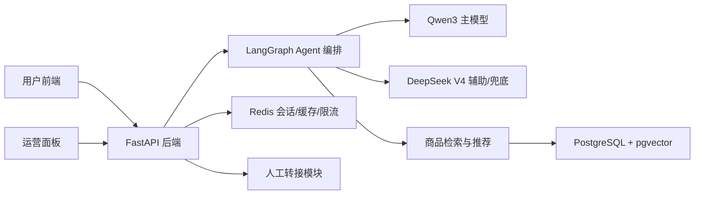
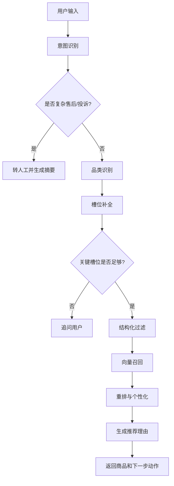

# 数码全类智能导购 Agent

## 1. 项目定位

本项目是一个面向数码全类商品的智能导购 Agent，目标是替代基础人工客服完成售前咨询、选品推荐、商品对比、下单引导和复杂售后转人工。

第一版聚焦商用 MVP，不直接接入真实电商平台，先使用自建模拟商品库验证完整业务闭环。覆盖品类包括手机、笔记本、平板、耳机、相机、智能手表等典型数码产品。

### 1.1 核心问题

传统电商客服在数码导购场景中常见问题：

- 咨询响应慢，用户等待时间长。
- 用户需求模糊时，人工客服追问成本高。
- 商品参数复杂，推荐容易只罗列配置，缺少购买理由。
- 用户历史行为、预算、使用场景没有被充分利用。
- 售后、投诉、保修争议转人工时上下文丢失。

### 1.2 目标能力

- 支持多轮对话，识别模糊、歧义和跨品类需求。
- 根据预算、品牌、用途、参数偏好和用户历史行为补全需求。
- 对接商品库做结构化筛选、语义召回和个性化推荐。
- 为每个推荐商品生成可信、可解释、和用户需求相关的推荐理由。
- 支持 2-3 个商品的参数对比、适合人群分析和购买建议。
- 针对投诉、退款、保修争议、低置信度回答自动转人工，并同步会话摘要。

## 2. 技术栈选型

| 模块 | 技术 | 选择原因 | 替代方案与取舍 |
|---|---|---|---|
| 后端 API | FastAPI | Python 生态友好，适合 AI 服务；类型校验、异步能力和自动 API 文档完善 | Flask 更轻但工程约束弱；Django 偏重，不适合 Agent MVP |
| Agent 编排 | LangGraph + LangChain | LangGraph 管理多轮状态机和分支流程；LangChain 负责模型、工具、Retriever 集成 | 纯 LangChain 对复杂状态流控制较弱；自研编排初期成本高 |
| 主模型 | Qwen3 API | 中文导购、多轮对话、结构化输出、工具调用更适合主链路 | OpenAI 效果强但成本和国内合规需评估 |
| 辅助模型 | DeepSeek V4 Flash/Pro API | 适合复杂对比、长上下文总结、复杂售后判断和模型兜底 | 全量使用 DeepSeek 可行，但主导购话术和槽位稳定性需实测 |
| 主数据库 | PostgreSQL + pgvector | 同时支持结构化数据、JSONB 参数、事务和向量检索，MVP 运维简单 | MySQL 生态成熟但向量检索集成弱；FAISS 不是完整在线数据库 |
| 缓存 | Redis | 用于会话缓存、热门推荐缓存、限流和模型调用保护 | 仅用数据库会增加延迟和并发压力 |
| 前端 | React + TypeScript + Vite + Ant Design + TanStack Query | 快速构建导购聊天页、推荐卡片、商品对比和运营面板 | Vue 也可行；本项目默认 React 生态 |
| ORM/迁移 | SQLAlchemy 2.0 + Alembic | Python 后端主流组合，适合可维护 schema 演进 | 直接写 SQL 简单但长期迁移成本高 |
| 测试 | pytest + httpx + Playwright | 覆盖后端单元、接口、Agent 场景和前端 E2E | 只做手测无法证明推荐链路稳定 |
| 部署 | Docker Compose | 本地一键启动 API、前端、PostgreSQL、Redis | Kubernetes 不适合 MVP 第一阶段 |

## 3. 系统架构

采用单体优先、模块化分层架构。第一版保持部署简单，后续可以按 Agent 服务、推荐服务、商品搜索服务拆分。



### 3.1 分层设计

| 层级 | 职责 |
|---|---|
| 前端展示层 | 聊天交互、推荐商品展示、商品对比、转人工状态、运营监控 |
| API 层 | 请求校验、鉴权预留、错误处理、接口聚合、响应格式统一 |
| Agent 编排层 | 意图识别、品类路由、槽位补全、模型路由、工具调用和状态流转 |
| 推荐检索层 | 商品结构化过滤、向量召回、排序重排、推荐理由上下文构造 |
| 数据层 | 用户、商品、会话、消息、推荐记录、反馈、人工工单 |
| 缓存层 | 会话短期状态、热点商品、限流计数、模型调用保护 |

## 4. Agent 流程设计

### 4.1 主流程



### 4.2 模型路由

| 任务 | 默认模型 | 说明 |
|---|---|---|
| 普通导购对话 | Qwen3 | 保持中文导购体验和结构化输出稳定 |
| 意图识别 | Qwen3 | 输出标准 intent、category、slots |
| 槽位补全 | Qwen3 | 根据上下文提取预算、用途、品牌、参数偏好 |
| 推荐理由生成 | Qwen3 | 结合商品真实字段生成，不允许编造参数 |
| 商品复杂对比 | DeepSeek V4 Flash | 长参数、跨品类或多商品对比时使用 |
| 长会话摘要 | DeepSeek V4 Flash | 人工转接前压缩上下文 |
| 售后争议判断 | DeepSeek V4 Pro | 退款、投诉、保修争议等低频复杂场景 |
| 主模型失败兜底 | DeepSeek V4 Flash | Qwen3 超时、失败或限流时切换 |

### 4.3 品类与核心槽位

| 品类 | 核心槽位 |
|---|---|
| 手机 | 预算、品牌、系统、拍照、游戏、续航、存储 |
| 笔记本 | 预算、用途、CPU/GPU、重量、屏幕、续航、内存 |
| 平板 | 预算、用途、屏幕、手写笔、生态、便携性 |
| 耳机 | 预算、佩戴方式、降噪、音质、通话、运动场景 |
| 相机 | 预算、拍摄场景、便携性、镜头生态、视频能力 |
| 智能手表 | 预算、手机生态、运动、健康监测、续航、外观 |

## 5. 后端设计

### 5.1 目录规划

```text
backend/
  app/
    main.py
    api/
      routes_chat.py
      routes_recommend.py
      routes_compare.py
      routes_handoff.py
      routes_feedback.py
    core/
      config.py
      logging.py
      errors.py
    agent/
      graph.py
      state.py
      prompts.py
      model_router.py
      tools.py
    catalog/
      retriever.py
      ranker.py
      vectorizer.py
      seed_data.py
    db/
      session.py
      models.py
      repositories.py
    schemas/
      chat.py
      product.py
      recommendation.py
      handoff.py
    tests/
      test_chat_api.py
      test_recommendation.py
      test_agent_flow.py
```

### 5.2 API 设计

| 接口 | 方法 | 职责 | 完成标准 |
|---|---|---|---|
| `/chat` | POST | 主对话入口，返回回复、推荐商品、下一步动作 | 能完成一次多轮导购 |
| `/recommend` | POST | 根据品类、槽位、用户历史返回商品候选 | 推荐结果来自数据库 |
| `/compare` | POST | 对比 2-3 个商品 | 输出差异、适合人群、购买建议 |
| `/handoff` | POST | 创建人工转接工单 | 包含摘要、原因、状态 |
| `/feedback` | POST | 记录点击、拒绝、购买、接管等反馈 | 后续可用于评估推荐质量 |
| `/health` | GET | 健康检查 | 返回 API、数据库、Redis 状态 |

### 5.3 响应约定

所有业务接口返回统一结构：

```json
{
  "success": true,
  "data": {},
  "error": null,
  "trace_id": "req_xxx"
}
```

错误时：

```json
{
  "success": false,
  "data": null,
  "error": {
    "code": "MODEL_TIMEOUT",
    "message": "模型响应超时，请稍后重试"
  },
  "trace_id": "req_xxx"
}
```

## 6. 前端设计

### 6.1 页面规划

| 页面 | 路由 | 职责 |
|---|---|---|
| 导购工作台 | `/` | 用户聊天、推荐商品、商品对比、转人工状态 |
| 商品库管理 | `/admin/products` | 查看模拟商品、筛选品类、检查参数字段 |
| 会话监控 | `/admin/conversations` | 查看会话、消息、转人工原因 |
| 推荐效果面板 | `/admin/metrics` | 查看推荐点击、拒绝、转人工、下单模拟指标 |

### 6.2 导购工作台布局

- 左侧：多轮聊天窗口，展示用户消息、Agent 回复、追问状态。
- 右侧上部：推荐商品卡片，展示价格、品牌、核心参数、推荐理由。
- 右侧中部：商品对比区，支持选择 2-3 个商品对比。
- 右侧下部：当前槽位状态，显示预算、品类、用途、品牌偏好等。
- 顶部：会话状态、模型状态、转人工入口。

### 6.3 前端验收

- 桌面端 1440px 宽度下聊天和推荐区不重叠。
- 移动端 390px 宽度下可完整完成聊天和查看推荐。
- 接口加载、空结果、模型失败、转人工中都有明确状态。
- 推荐卡片中的价格、参数、理由来自后端接口，不写死在前端。

## 7. 数据库设计

### 7.1 核心表

#### users

| 字段 | 类型 | 说明 |
|---|---|---|
| id | UUID | 用户 ID |
| nickname | VARCHAR | 昵称 |
| preferences | JSONB | 品牌、预算、品类偏好 |
| member_level | VARCHAR | 会员等级 |
| created_at | TIMESTAMP | 创建时间 |

#### products

| 字段 | 类型 | 说明 |
|---|---|---|
| id | UUID | 商品 ID |
| name | VARCHAR | 商品名称 |
| category | VARCHAR | 品类 |
| brand | VARCHAR | 品牌 |
| price | NUMERIC | 当前价格 |
| stock | INTEGER | 库存 |
| selling_points | TEXT | 卖点 |
| after_sales_policy | TEXT | 售后政策 |
| tags | TEXT[] | 推荐标签 |
| embedding | vector | 商品语义向量 |
| created_at | TIMESTAMP | 创建时间 |

#### product_specs

| 字段 | 类型 | 说明 |
|---|---|---|
| id | UUID | 参数记录 ID |
| product_id | UUID | 商品 ID |
| specs | JSONB | 不同品类的差异化参数 |

#### user_events

| 字段 | 类型 | 说明 |
|---|---|---|
| id | UUID | 行为 ID |
| user_id | UUID | 用户 ID |
| product_id | UUID | 商品 ID |
| event_type | VARCHAR | view、favorite、cart、order、refund |
| payload | JSONB | 行为上下文 |
| created_at | TIMESTAMP | 行为时间 |

#### conversations

| 字段 | 类型 | 说明 |
|---|---|---|
| id | UUID | 会话 ID |
| user_id | UUID | 用户 ID |
| current_intent | VARCHAR | 当前意图 |
| current_category | VARCHAR | 当前品类 |
| slots | JSONB | 当前已补全槽位 |
| status | VARCHAR | active、handoff、closed |
| created_at | TIMESTAMP | 创建时间 |
| updated_at | TIMESTAMP | 更新时间 |

#### messages

| 字段 | 类型 | 说明 |
|---|---|---|
| id | UUID | 消息 ID |
| conversation_id | UUID | 会话 ID |
| role | VARCHAR | user、assistant、system |
| content | TEXT | 消息内容 |
| model_name | VARCHAR | 生成模型 |
| created_at | TIMESTAMP | 创建时间 |

#### recommendations

| 字段 | 类型 | 说明 |
|---|---|---|
| id | UUID | 推荐记录 ID |
| conversation_id | UUID | 会话 ID |
| product_id | UUID | 商品 ID |
| rank_score | NUMERIC | 排序分 |
| reason | TEXT | 推荐理由 |
| created_at | TIMESTAMP | 推荐时间 |

#### feedback

| 字段 | 类型 | 说明 |
|---|---|---|
| id | UUID | 反馈 ID |
| conversation_id | UUID | 会话 ID |
| product_id | UUID | 商品 ID |
| feedback_type | VARCHAR | click、reject、buy、handoff |
| note | TEXT | 补充说明 |
| created_at | TIMESTAMP | 反馈时间 |

#### handoff_tickets

| 字段 | 类型 | 说明 |
|---|---|---|
| id | UUID | 工单 ID |
| conversation_id | UUID | 会话 ID |
| reason | VARCHAR | 转人工原因 |
| summary | TEXT | 会话摘要 |
| status | VARCHAR | open、assigned、closed |
| created_at | TIMESTAMP | 创建时间 |

### 7.2 索引策略

| 索引 | 用途 |
|---|---|
| `products(category, brand, price)` | 商品结构化筛选 |
| `products USING ivfflat (embedding vector_cosine_ops)` | 商品向量召回 |
| `user_events(user_id, event_type, created_at)` | 个性化历史行为查询 |
| `messages(conversation_id, created_at)` | 会话回放和摘要 |
| `recommendations(conversation_id, created_at)` | 推荐链路追踪 |

## 8. 模拟商品库设计

第一版每个品类准备 20-50 个商品，总量控制在几百条以内。每个商品必须包含：

- 基础字段：名称、品类、品牌、价格、库存。
- 核心参数：按品类写入 `product_specs.specs`。
- 卖点描述：用于向量化和推荐理由。
- 适用人群：学生、办公、游戏、摄影、运动、长辈等。
- 使用场景：通勤、学习、差旅、游戏、拍摄、运动等。
- 售后政策：退换、保修、延保说明。

模拟数据必须支持以下测试样例：

- 3000 元预算送礼。
- 5000 元以内游戏本。
- 拍照好、续航强的手机。
- 运动降噪耳机。
- 学习记笔记平板。
- 适合长辈的智能手表。

## 9. 测试方案

### 9.1 后端测试

| 测试类型 | 工具 | 覆盖内容 |
|---|---|---|
| 单元测试 | pytest | 意图识别、槽位补全、商品过滤、推荐排序、转人工判断 |
| 接口测试 | pytest + httpx/FastAPI TestClient | `/chat`、`/recommend`、`/compare`、`/handoff`、`/feedback` |
| 数据库测试 | pytest | 商品筛选、向量召回、用户历史查询 |
| Agent 场景测试 | pytest | 多轮对话、追问、推荐、对比、转人工 |

### 9.2 前端测试

| 测试类型 | 工具 | 覆盖内容 |
|---|---|---|
| 组件测试 | Vitest | 推荐卡片、聊天消息、槽位状态、对比表格 |
| E2E 测试 | Playwright | 完整导购流程、商品对比、转人工 |
| 视觉检查 | Playwright screenshot | 桌面端和移动端布局、空状态、错误状态 |

### 9.3 推荐质量测试

至少维护一组固定评测集：

| 用户输入 | 期望结果 |
|---|---|
| 预算 3000，送女生数码产品 | 推荐耳机、手表、手机等礼物向商品，并解释送礼理由 |
| 5000 内游戏本 | 返回笔记本品类，优先性能、显卡、散热 |
| 拍照好续航强的手机 | 返回手机品类，追问预算或给出多价位候选 |
| 这两个哪个好 | 使用上下文商品做对比，不脱离会话 |
| 我要投诉退款 | 触发人工转接并生成摘要 |

## 10. 验收标准

第一版达到以下效果才算完成：

- 用户能在前端完成一次完整导购对话。
- Agent 能识别数码品类，并根据预算、用途、品牌、参数偏好补全需求。
- 推荐结果来自数据库检索，不允许模型凭空编造商品。
- 每个推荐商品都有明确、可信、个性化的推荐理由。
- 支持 2-3 个商品的参数对比和购买建议。
- 复杂售后、投诉、低置信度问题能转人工，并生成会话摘要。
- 后端核心接口测试通过。
- Agent 固定场景评测通过。
- 前端关键流程在桌面端和移动端可用。
- Docker Compose 可以本地启动 API、前端、PostgreSQL、Redis。
- 本 README 的任务清单状态准确，已做和未做一眼可见。

## 11. 开发任务清单

### 11.1 架构与文档

- [x] 明确项目定位：数码全类智能导购 Agent。
- [x] 明确主技术栈：FastAPI、LangGraph/LangChain、Qwen3、DeepSeek V4、PostgreSQL/pgvector、Redis、React。
- [x] 创建 README 总控文档。
- [ ] 创建架构决策记录 ADR 文档。

### 11.2 后端

- [ ] 创建后端项目结构。
- [ ] 配置 FastAPI 应用入口。
- [ ] 配置 Pydantic v2 配置管理。
- [ ] 配置 SQLAlchemy 2.0 数据库连接。
- [ ] 配置 Alembic 迁移。
- [ ] 实现统一响应结构和错误处理。
- [ ] 实现 `/health` 健康检查接口。
- [ ] 实现 `/chat` 主对话接口。
- [ ] 实现 `/recommend` 推荐接口。
- [ ] 实现 `/compare` 商品对比接口。
- [ ] 实现 `/handoff` 人工转接接口。
- [ ] 实现 `/feedback` 用户反馈接口。

### 11.3 Agent 与推荐

- [ ] 定义 Agent 状态结构。
- [ ] 实现意图识别节点。
- [ ] 实现品类识别节点。
- [ ] 实现槽位补全节点。
- [ ] 实现结构化商品过滤。
- [ ] 实现商品向量化。
- [ ] 实现 pgvector 语义召回。
- [ ] 实现推荐重排。
- [ ] 实现推荐理由生成。
- [ ] 实现 Qwen3 主模型调用。
- [ ] 实现 DeepSeek V4 辅助模型调用。
- [ ] 实现模型超时和降级兜底。
- [ ] 实现复杂问题转人工判断。

### 11.4 数据库与数据

- [ ] 设计并实现数据库 schema。
- [ ] 创建 `users` 表。
- [ ] 创建 `products` 表。
- [ ] 创建 `product_specs` 表。
- [ ] 创建 `user_events` 表。
- [ ] 创建 `conversations` 表。
- [ ] 创建 `messages` 表。
- [ ] 创建 `recommendations` 表。
- [ ] 创建 `feedback` 表。
- [ ] 创建 `handoff_tickets` 表。
- [ ] 创建 pgvector 扩展和向量索引。
- [ ] 构造模拟数码商品库。
- [ ] 编写商品数据导入脚本。

### 11.5 前端

- [ ] 创建前端项目结构。
- [ ] 配置 React、TypeScript、Vite。
- [ ] 配置 Ant Design。
- [ ] 配置 TanStack Query。
- [ ] 实现导购聊天页面。
- [ ] 实现推荐商品卡片。
- [ ] 实现商品对比区。
- [ ] 实现槽位状态展示。
- [ ] 实现人工转接状态。
- [ ] 实现商品库管理页面。
- [ ] 实现会话监控页面。
- [ ] 实现推荐效果面板。
- [ ] 完成桌面端响应式布局。
- [ ] 完成移动端响应式布局。

### 11.6 测试与质量

- [ ] 编写后端单元测试。
- [ ] 编写后端接口测试。
- [ ] 编写数据库检索测试。
- [ ] 编写 Agent 场景测试。
- [ ] 编写推荐质量评测集。
- [ ] 编写前端组件测试。
- [ ] 编写 Playwright E2E 测试。
- [ ] 完成桌面端截图检查。
- [ ] 完成移动端截图检查。

### 11.7 部署与运维

- [ ] 编写后端 Dockerfile。
- [ ] 编写前端 Dockerfile。
- [ ] 编写 Docker Compose 本地部署。
- [ ] 配置 PostgreSQL + pgvector 容器。
- [ ] 配置 Redis 容器。
- [ ] 配置环境变量模板。
- [ ] 配置结构化日志。
- [ ] 配置基础监控指标。

### 11.8 最终验收

- [ ] 完成一次端到端导购演示。
- [ ] 完成商品对比演示。
- [ ] 完成人工转接演示。
- [ ] 核心后端测试通过。
- [ ] 前端关键流程测试通过。
- [ ] Docker Compose 本地启动通过。
- [ ] 更新 README 任务状态。

## 12. 当前状态

| 模块 | 状态 | 说明 |
|---|---|---|
| 项目定位 | 已完成 | 已确定为数码全类智能导购 Agent |
| 技术栈 | 已完成 | 已确定 Qwen3 主模型、DeepSeek V4 辅助模型 |
| README 总控文档 | 已完成 | 当前文档作为后续开发状态跟踪入口 |
| 后端实现 | 未开始 | 待创建 FastAPI 项目结构 |
| 前端实现 | 未开始 | 待创建 React 项目结构 |
| 数据库 schema | 未开始 | 待创建 Alembic 迁移 |
| 模拟商品库 | 未开始 | 待构造数码商品数据 |
| 测试体系 | 未开始 | 待创建 pytest、Playwright 测试 |
| Docker 部署 | 未开始 | 待创建 Docker Compose |

